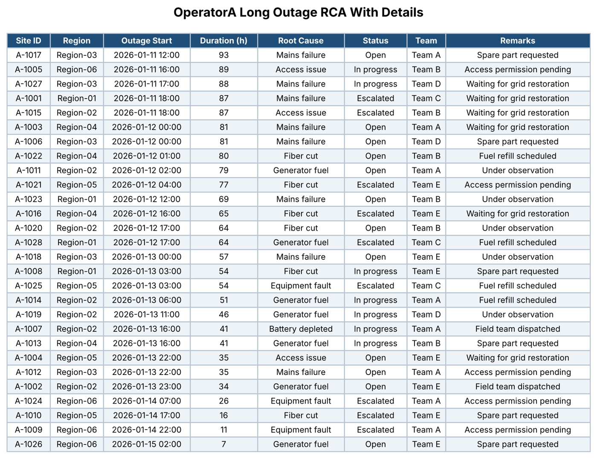

# Long-Outage RCA Reports

Hourly, unattended pipeline that turns Excel RCA tables into **hi-res images and PDFs** and posts them to **Telegram** and **WhatsApp** groups.

> **Sanitized showcase.** The production version runs inside a telecom operations center and its code and data are confidential. This repo shows the same technique with **generated sample data**. No company names, credentials, group IDs or real site data are included.



## How it works

```
Excel workbook ──► render every table ──► PNG  ──► Telegram group
 (RCA tables)      (all rows + columns)   PDF  ──► WhatsApp group
                                                     ▲
                    Task Scheduler, every hour ──────┘
```

| Step | File | What it does |
|------|------|--------------|
| 1 | `generate_sample_data.py` | Creates a fake RCA workbook with two operator sheets |
| 2 | `render_snapshot.py` | Renders each table to a 200 DPI PNG and a one-page PDF, then trims the white margin |
| 3 | `send_telegram.py` | Sends the PNGs as documents, so Telegram keeps full resolution |
| 4 | `send_whatsapp.py` | Sends the PDFs through WhatsApp Web with Playwright |
| 5 | `run_all.py` | Runs everything once, with a lock file so overlapping hourly runs are skipped |

## Problems solved

- **Nothing may be cut off.** Management reads these tables on phones, so every row and every column must be visible. The production backend sets the print area to the used range and uses **fit to 1 page wide x 1 page tall** on A3 landscape. It exports with `ExportAsFixedFormat` and rasterises at 200 DPI with PyMuPDF.
- **Excel's own copy-as-picture was unreliable.** `CopyPicture` blacked out off-screen areas, and the metafile paste dropped banded rows. Going through PDF gives a pixel-accurate result every time.
- **WhatsApp ruins wide images.** Photos get compressed until the text is unreadable, so WhatsApp receives the PDF and Telegram receives the PNG.
- **WhatsApp Web won't attach PDFs through its file input.** The page only exposes an image-only input, which silently drops PDFs. The file is copied to the OS clipboard and pasted with `Ctrl+V` instead.
- **Two message boxes look the same.** After pasting, the caption box and the chat box are both labelled "Type a message". Only the chat box adds `to <name>`, and that suffix is how the script tells them apart.
- **Runs must never pile up.** `run.lock` skips a run while the previous one is still going, and the scheduled task has a 20-minute time limit.

## Quick start

```bash
pip install -r requirements.txt
python run_all.py          # DRY_RUN=1 by default: renders files, logs what it would send
```

The images and PDFs appear in `output/`.

### Send for real

```bash
cp .env.example .env       # fill in TELEGRAM_BOT_TOKEN, TELEGRAM_CHAT_ID, WHATSAPP_GROUP
# set DRY_RUN=0 in .env
playwright install chromium
python run_all.py          # first run: scan the WhatsApp QR code once; the profile is kept
```

### Use the Excel backend (Windows)

Set `USE_EXCEL=1` in `.env`. Rendering then goes through Microsoft Excel (`pywin32`) and PyMuPDF, so the output matches Excel's own formatting exactly.

### Schedule it

On Windows, point Task Scheduler at `run_report.bat`. Run it hourly with **Run only when user is logged on**, because Excel and WhatsApp Web need a desktop session. Set a 20-minute execution time limit.

## Tech

Python · openpyxl · Excel COM (pywin32) · PyMuPDF · Pillow · matplotlib · Telegram Bot API · Playwright · Windows Task Scheduler

## License

MIT
